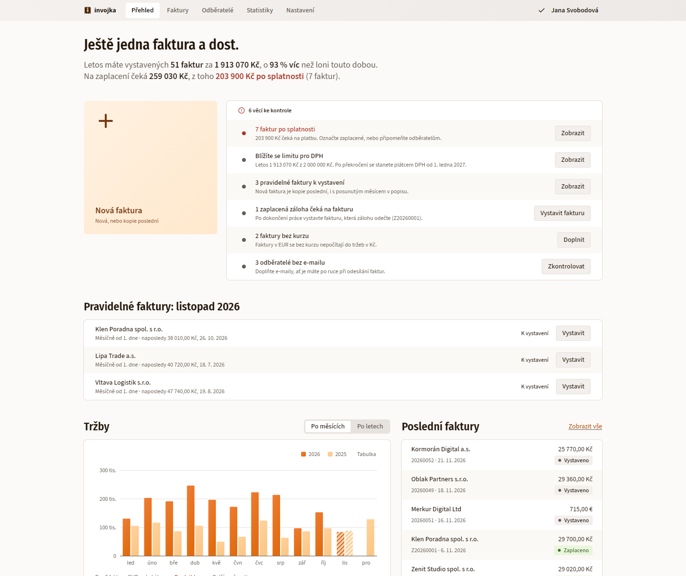

**Stáhněte `invojka.html`** (níže v části Assets), uložte ho třeba na plochu a otevřete dvojklikem v **Chrome nebo Edge**. Nic se neinstaluje a funguje i offline. Při prvním spuštění vyberete složku, kam se budou ukládat vaše data. Pokud už Invojku používáte, nahraďte starý soubor tímto. Vaše data zůstanou, kde jsou.

**Download `invojka.html`** (under Assets below), save it anywhere, for example on your desktop, and open it in **Chrome or Edge**. Nothing to install, and it works offline. On first launch you choose a folder for your data. If you already use Invojka, replace the old file with this one; your data stays where it is.

## Co je nového / What's new

- **Faktura se píše ve čtyřech krocích:** Odběratel, Položky, Termíny a platba, Kontrola a vystavení. V kontrole vidíte hotové PDF a upozornění na to, co chybí; teprve tam je tlačítko „Vystavit“. Kdo nic měnit nechce, přeskočí z položek rovnou ke kontrole. Rozpracovaná faktura se mezi kroky sama ukládá jako koncept.
  *An invoice is written in four steps: Customer, Items, Dates and payment, Review and issue. The review shows the finished PDF and what is still missing, and only there is the "Vystavit" (Issue) button. If nothing needs changing, you can jump from the items straight to the review. The draft is saved as you move between steps.*
- **Číslo dostane faktura až při vystavení:** koncept má číslo jen předběžné, takže rozpracovaná nebo smazaná faktura už neudělá díru v číselné řadě. Číslo, které napíšete sami, zůstane.
  *An invoice gets its number when it is issued: a draft's number is provisional, so a waiting or deleted draft no longer leaves a gap in the series. A number you type yourself is kept.*
- **Výběr odběratele říká víc:** u každého vidíte město, IČ, poslední fakturu (datum, částku a za co byla) a kolik faktur má po splatnosti. Nová faktura se předvyplní podle té poslední a krok s položkami to řekne.
  *The customer list says more: city, company ID, the last invoice (date, amount and what it was for) and how many are overdue. A new invoice is filled in from the last one, and the items step says so.*
- **Termíny a platba:** číslo účtu, na který má odběratel platit, je vidět přímo u faktury; splatnost o víkendu nebo ve svátek jde jedním klikem posunout na další pracovní den. Měna se vybírá u položek, kde se v ní píšou ceny.
  *Dates and payment: the bank account the customer pays to is shown with the invoice; a due date on a weekend or a Czech public holiday can be moved to the next working day in one click. The currency is chosen with the items, where prices are typed in it.*
- **Nový výchozí vzhled Terakota:** meruňková tlačítka, teplé šedé a stavové barvy laděné do stejné rodiny. V Nastavení → Aplikace přibyla zelená schémata (Šalvěj, Máta, Louka, Pistácie a další) a Jasný oblak. Kdo si schéma vybral dřív, má ho dál.
  *A new default look, Terakota (Terracotta): apricot buttons, warm greys and status colours from the same family. Settings → App has new green schemes (Sage, Mint, Meadow, Pistachio and more) and Bright cloud. A scheme you picked earlier stays.*
- **Tabulky faktur a odběratelů:** čitelnější písmo (název a částka vedou, „Kč“ je tišší), řádky oddělené linkou a záhlaví ve světlém pásu.
  *The invoice and customer tables: clearer type (the name and the amount lead, the currency is quieter), rows parted by a line and a pale header band.*
- **Odhad daní:** počítá s odpočty, dalšími slevami a s měsícem, kdy jste začali podnikat.
  *The tax estimate takes deductions, other credits and the month you started the business into account.*
- **Drobnosti:** popis položky se roztáhne, aby byl vidět celý; Nastavení má záložky; pozdravy na Přehledu už nikoho neoslovují jako pána.
  *Small things: an item's description grows so all of it shows; Settings has tabs; the greetings on Home no longer address anyone as a man.*

Data zůstávají jen ve vaší složce jako obyčejné soubory JSON. Ven jde jen měna a datum při stahování kurzů a IČ nebo název, které sami napíšete do hledání v ARES.
*Your data stays in your folder as plain JSON files. The only things sent out are currencies and dates when fetching exchange rates, and the IČ or name you type into the ARES lookup.*
